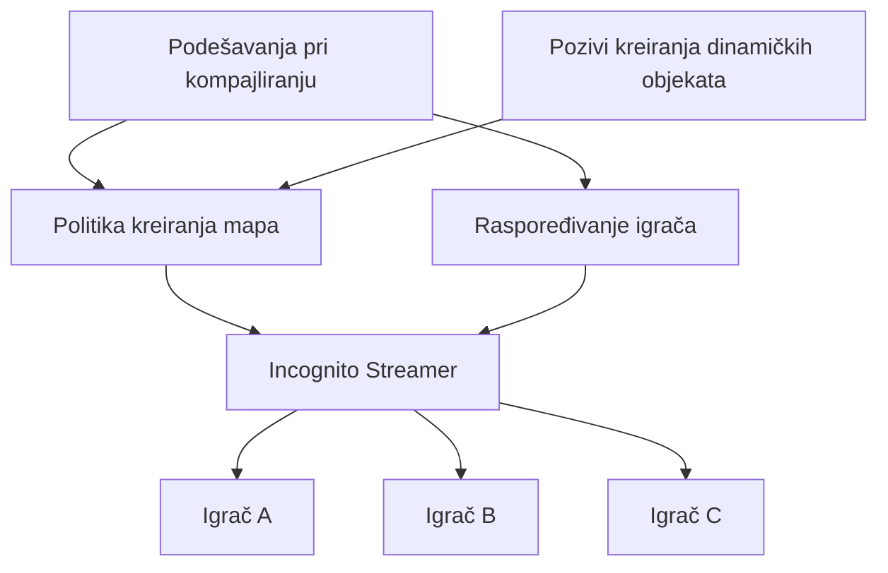

# MapPulse

**Autor:** [0xOgysha](https://github.com/0xOgysha) · Kreirano: 26.11.2026. · Copyright (c) 2026 0xOgysha

[English](README.md) | **Srpski**

**Adaptivno učitavanje mapa i inteligentna prioritizacija objekata za SA-MP i open.mp.**


MapPulse je lagana Pawn ekstenzija izgrađena na postojećem Incognito Streamer pluginu. Kombinuje matematičku procenu kretanja igrača, prilagođavanje radijusa učitavanja raspoloživom kapacitetu i prioritizaciju objekata prema modelu, radi efikasnijeg korišćenja dostupnog kapaciteta streaminga.

Projekat je zasnovan na jednostavnom principu: **automatska optimizacija, bez potrebe da igrači ručno učitavaju mape.** MapPulse ne zamenjuje Streamer, već predstavlja dodatni sloj za upravljanje njegovim ponašanjem u postojećim gamemode skriptama.

> **Status razvoja:** v1.0.3 je eksperimentalno izdanje izvornog koda. Ciljne platforme su SA-MP 0.3.7 i open.mp; uspešno kompajliranje, kompatibilnost tokom rada i poboljšanja performansi još nisu potvrđeni na obe platforme. Ovo je testna verzija 1.0.2, ne potvrđeno stabilno izdanje. Pre produkcijske primene testirajte sistem na probnom serveru.

## Sadržaj

- [Funkcionalnosti](#funkcionalnosti)
- [Zahtevi](#zahtevi)
- [Instalacija](#instalacija)
- [Arhitektura](#arhitektura)
- [Matematički pristup](#matematički-pristup)
- [Politika objekata](#politika-objekata)
- [Podešavanja](#podešavanja)
- [Administratorske komande](#administratorske-komande)
- [Provera zavisnosti](#provera-zavisnosti)
- [Testiranje performansi](#testiranje-performansi)
- [Ograničenja i rešavanje problema](#ograničenja-i-rešavanje-problema)
- [Doprinos projektu](#doprinos-projektu)

## Funkcionalnosti

- Automatsko upravljanje radijusom streaminga pojedinačno za svakog igrača, na osnovu uzorkovanja kretanja i raspoloživog kapaciteta objekata.
- Primena pravila pri pozivima `CreateDynamicObject` i `CreateDynamicObjectEx`.
- Prioriteti prema modelu i selektivno smanjivanje udaljenosti učitavanja dekoracija.
- Jedan zajednički timer sa ograničenim obimom posla i kružnim raspoređivanjem povezanih igrača (round-robin).
- Poređenje kvadrata udaljenosti, izglađivanje kvadrata brzine i predviđanje popunjenosti.
- Histereza, zahtev za stabilnim uzorcima i ograničena učestalost promena radijusa.
- Bez obrade kroz `OnPlayerUpdate` i prisilnih poziva `Streamer_Update` ili `Streamer_UpdateEx`.
- Očuvanje eksplicitnih nenultih prioriteta i spoljašnjih promena radijusa igrača kada se detektuju.
- ASCII logo pri pokretanju, dijagnostika zavisnosti, RCON komande i A/B izveštaji.
- Centralizovana konfiguracija pri kompajliranju, bez posebnog MapPulse konfiguracionog fajla tokom rada ili baze podataka.

## Zahtevi

| Zavisnost | Preporučena verzija / zahtev | Namena |
| --- | --- | --- |
| SA-MP 0.3.7 ili open.mp | Kompatibilan server i Pawn kompajler | Serversko okruženje |
| `a_samp.inc` | Kompatibilan sa ciljnom platformom | Pawn serverski API; potreban i za kompajliranje filterscripta za open.mp |
| [Incognito Streamer](https://github.com/samp-incognito/samp-streamer-plugin/releases) | 2.9.6 (`0x296`) ili kompatibilna novija verzija | API dinamičkih objekata; potrebni su usklađeni plugin i `streamer.inc` |
| [Pawn.CMD](https://github.com/katursis/Pawn.CMD/releases) | 3.4.0 za SA-MP; [3.4.0-omp](https://github.com/katursis/Pawn.CMD/releases/tag/3.4.0-omp) za open.mp | Opcioni procesor komandi, podrazumevano uključen |

Instalirajte binarne fajlove odgovarajuće platforme i pripadajuće include fajlove. Gamemode mora koristiti `CreateDynamicObject` ili `CreateDynamicObjectEx` da bi pravila optimizacije pri kreiranju uticala na njegove mape. Filterscript može raditi samostalno, ali tada omogućava samo individualno upravljanje radijusom.

YSI, MySQL, sscanf i dodatni MapPulse plugin nisu potrebni. Postojeće zavisnosti gamemode-a ostaju nepromenjene. Na open.mp koristite odgovarajući SA-MP kompatibilni include i ispravnu Pawn.CMD komponentu ako je uključena. Ako Pawn.CMD nije instaliran, isključite ga u podešavanjima.

## Instalacija

### 1. Kopiranje izvornih fajlova

```text
MapPulse/
├── filterscripts/
│   ├── mappulse.pwn
│   └── mappulse_live.inc
└── include/
    ├── mappulse_maps.inc
    └── mappulse_settings.inc
```

Kopirajte oba filterscript fajla u serverski direktorijum `filterscripts/`. Oba javna include fajla kopirajte u direktorijum include fajlova kompajlera (najčešće `pawno/include/` za SA-MP ili `qawno/include/` za open.mp, odnosno drugu podešenu putanju). Proverite da su `streamer.inc` i, ako je uključen, `Pawn.CMD.inc` dostupni kompajleru uz tačno pisanje naziva iz koda (`<Pawn.CMD>`).

### 2. Aktiviranje optimizacije pri kreiranju mapa

U gamemode dodajte include **nakon Streamer include-a, a pre koda i modula koji kreiraju objekte**:

```pawn
#include <a_samp>
#include <streamer>
#include <mappulse_maps>
```

Ako gamemode već koristi nativne open.mp include fajlove, zadržite postojeći serverski API i dodajte MapPulse nakon Streamera. Nemojte dodavati drugi, konfliktni serverski API include.

Postojeće pozive za kreiranje dinamičkih objekata nije potrebno menjati:

```pawn
new objectid = CreateDynamicObject(19448, 1000.0, 1000.0, 20.0,
    0.0, 0.0, 0.0);
```

Include preusmerava naredne pozive u istoj kompajliranoj skripti kroz MapPulse funkcije. Podržana su oba API-ja za kreiranje. Nema potrebe za ručnim `#undef` direktivama niti završnim include fajlom. Pozivi u odvojenim filterscriptovima ili drugim AMX skriptama nisu obuhvaćeni ako i oni ne koriste isti modul za mape. Već kreirani objekti ne menjaju se retroaktivno.

Opciono, u **postojeći** `OnGameModeInit`, nakon kreiranja mapa, dodajte:

```pawn
MPM_PrintStats();
```

Funkcija ispisuje broj uspešno kreiranih objekata, objekata kojima je dodeljen prioritet i objekata kojima je skraćena udaljenost streaminga. Brojači su kumulativni po skripti, a ne skeniranje trenutno postojećih objekata. Prvi preusmereni poziv za kreiranje objekta pokreće i jednokratnu proveru verzije Streamer include-a.

### 3. Kompajliranje i učitavanje filterscripta

Kompajlirajte `filterscripts/mappulse.pwn` u `filterscripts/mappulse.amx`. Ponovo kompajlirajte gamemode ako ste instalirali include za mape.

Za SA-MP dodajte `mappulse` na postojeću liniju `filterscripts` u `server.cfg`:

```ini
filterscripts mappulse
```

Za open.mp dodajte `filterscripts/mappulse` u postojeći niz `pawn.side_scripts` u `config.json`:

```json
{
  "pawn": {
    "side_scripts": ["filterscripts/mappulse"]
  }
}
```

Ovo su minimalni primeri; zadržite postojeće stavke i konfiguraciju. Učitajte Streamer kao kompatibilan serverski plugin, a Pawn.CMD, ako je uključen, prema uputstvu za odgovarajuću platformu. open.mp izdanje Pawn.CMD-a pripada direktorijumu `components/`. Nemojte istovremeno učitavati stare SmartMap, PawnMapFlow ili dodatne MapPulse filterscriptove.

### 4. Pokretanje i provera

Pokrenite server, pregledajte poruke o zavisnostima i kao RCON administrator koristite `/mpstatus`. Sa podrazumevanim podešavanjima individualna optimizacija pokreće se automatski. Igrači ne moraju koristiti komande.

MapPulse podešavanja se kompajliraju u skripte; navedena serverska konfiguracija služi samo za učitavanje filterscripta.

## Arhitektura

| Fajl | Namena |
| --- | --- |
| `filterscripts/mappulse.pwn` | Ulazna tačka filterscripta, callbackovi životnog ciklusa, opcione nativne komande i odgovori na dialog |
| `filterscripts/mappulse_live.inc` | Raspoređivanje igrača, procena kretanja, politika radijusa, dijagnostika, A/B testovi i komande |
| `include/mappulse_maps.inc` | Funkcije za preusmeravanje kreiranja dinamičkih objekata, klasifikacija modela, politika kreiranja i brojači |
| `include/mappulse_settings.inc` | Svih 73 korisničkih DEFINE podešavanja, validacija pri kompajliranju i provera zavisnosti |



Dva modula se dopunjuju. Include upravlja parametrima odgovarajućih objekata pri kreiranju, dok filterscript nezavisno upravlja multiplikatorom radijusa za svakog igrača koji ispunjava uslove. Nijedan modul ne zamenjuje osnovnu implementaciju Streamera.

## Matematički pristup

Pri razvoju MapPulse-a korišćene su jednostavne numeričke metode umesto skupih proračuna nad svakim objektom pri svakom ažuriranju igrača. Sledeće formule opisuju implementiranu politiku v1.0.2, a ne izmerene rezultate performansi.

### 1. Kvadrat euklidske udaljenosti i brzine

Za dve uzastopne pozicije, kvadrat pomeraja iznosi:

$$d^2 = (x_t-x_{t-1})^2+(y_t-y_{t-1})^2+(z_t-z_{t-1})^2$$

Za interval uzorkovanja $\Delta t$ u milisekundama, procena kvadrata brzine u $(\mathrm{km/h})^2$ iznosi:

$$v^2 = d^2\left(\frac{3600}{\Delta t}\right)^2$$

Pri konverziji se koordinate igre tretiraju kao metri. Poređenjem kvadrata brzine sa kvadratima pragova izbegava se računanje kvadratnog korena tokom uobičajene automatske optimizacije. Kvadratni koren koristi se pri prikazu stvarnih brzina i udaljenosti rute u administratorskoj dijagnostici.

### 2. Eksponencijalno izglađivanje

Ponderisana pokretna procena ublažava nagle promene izazvane pojedinačnim uzorcima:

$$s_t=(1-\alpha)s_{t-1}+\alpha v_t^2$$

Ovde je $s_t$ izglađeni kvadrat brzine, a $\alpha$ je `MPL_SPEED_WEIGHT` (podrazumevano 0.5). Poređenje sa pragovima koristi ovu izglađenu vrednost. To je procena iz uzoraka pozicije, a ne direktno merenje brzine vozila.

Veliki pomeraji, predugi intervali između uzoraka i promene virtualnog sveta ili enterijera resetuju procenu kretanja. Prag pomeraja je `max(MPL_JUMP_DISTANCE, MPL_JUMP_METERS_PER_MS × elapsed_ms)`. Ovi događaji ne izazivaju prisilno ažuriranje Streamera.

### 3. Predviđanje radijusa prema raspoloživom kapacitetu

Neka $N$ označava trenutni broj vidljivih dinamičkih objekata, a $L$ podešeni limit vidljivih objekata po igraču. Neka su $r_0$ originalni multiplikator radijusa, $r_c$ trenutni multiplikator i $q$ ciljna popunjenost izražena kao razlomak (podrazumevano 0.75).

Za približno ravnomernu dvodimenzionalnu raspodelu objekata, njihov broj u okolini raste proporcionalno kvadratu radijusa. Za predloženi faktor $f$ u odnosu na originalni multiplikator:

$$\widehat{N}(f)=N\left(\frac{r_0f}{r_c}\right)^2$$

Iz uslova $\widehat{N}(f)\leq qL$ sledi:

$$f^2\leq\frac{qL}{N}\left(\frac{r_c}{r_0}\right)^2$$

MapPulse direktno proverava ovu nejednakost, bez izračunavanja kvadratnog korena. Ako nema vidljivih objekata, procena se preskače. Faktor se bira iz podešenih nivoa brzine; ako kapacitet ne dozvoljava najveći nivo, algoritam pokušava srednji, a zatim originalni radijus. Primenjuje se i podešena apsolutna gornja granica multiplikatora, bez namernog smanjivanja postojeće bazne vrednosti.

Ova aproksimacija zasnovana na površini je heuristika. Guste grupe objekata, višespratni enterijeri, prioriteti i različite udaljenosti streaminga mogu dati rezultate drugačije od predviđenog broja.

### 4. Histereza i raspoređivanje

**Adaptive Streaming v2 (1.0.2).** Pri najmanje 85% popunjenosti, tri uzastopna visoka uzorka i razmaku od šest sekundi, radijus se smanjuje za najviše 5% baze po koraku (ako je iznad baze, prvo se vrati na bazu), najniže do 85% baze. Smanjenje je ograničeno na vozače/putnike pri brzini od najmanje MPL_DRIVE_SPEED u svetu 0, enterijeru 0. Broj vidljivih objekata na limitu je cenzurisan, pa se ne koristi kao tačna gustina. Radijus se zadržava između pragova; pri tri niska uzorka (<=60%) i dovoljnim vremenskim razmakom, oporavak ide korak po korak prema bazi ako procena površine ne prelazi cilj od 75%. Van uslova smanjenja (zaustavljanje, izlazak iz vozila, promena sveta/enterijera ili skok) vraća se bazni radijus kada je MapPulse vlasnik vrednosti. Ovo može uticati na vidljivost i koliziju; testirati pažljivo. Ako i na donjoj granici ostaje pun kapacitet, ne smanjuje se dalje. /mpstatus prikazuje trenutno zasićenje, granicu, brojače i razlog poslednjeg stanja; A/B beleži minimalni izmereni radijus. U A testu nema adaptacije. Isključivanje MPL_ADAPTIVE_REDUCTION vraća prethodnu politiku.

Zajednički timer od 100 ms posećuje najviše 16 aktivnih slotova po prolazu, uz meki budžet od 2 ms. Redovni uzorci su udaljeni najmanje 1.5 sekundi; igrači koji miruju, ispunjavaju uslove i nemaju aktivnu promenu radijusa koriste interval od 2.5 sekundi. Lista aktivnih igrača koristi uklanjanje zamenom sa poslednjim elementom umesto skeniranja svih slotova pri svakom prolazu timera. Stvarni intervali mogu biti duži pod opterećenjem. Budžet se proverava nakon pojedinačnih operacija i nije stroga garancija izvršavanja u realnom vremenu.

## Politika objekata

Podrazumevana politika menja samo pozive sa prioritetom `0`, pozitivnom udaljenošću streaminga i neograničenim filterima igrača i oblasti, u svetu/enterijeru `0` ili `-1`. Kod proširenog API-ja svaki niz svetova, enterijera, igrača i oblasti mora sadržati tačno jedan kompatibilan element. Ostali pozivi se prosleđuju bez promena politike.

| Kategorija | Podrazumevani prioritet / politika |
| --- | --- |
| Lista modela visokog prioriteta | `3` |
| Lista modela srednjeg prioriteta | `2` |
| Odabrani dekorativni model (`14400`) | Udaljenost streaminga × `0.85`, uz ograničenja |
| Poznati strukturni modeli bez pravila | Geometrijski prioritet ako je uključen (podrazumevano isključen) |
| Nepoznati modeli ili eksplicitan prioritet različit od nule | Originalni parametri |

Liste modela su podesive i treba ih proveriti za mape svakog servera. ID modela nije dokaz da objekat u konkretnoj sceni predstavlja pod, zid ili isključivo dekoraciju. Podrazumevane liste obuhvataju odabrane građevinske modele, ne sve moguće konstrukcije.

Za pravilo dekoracija originalna udaljenost streaminga mora biti između 120 i 500 jedinica. Predložena udaljenost je najveća od sledećih vrednosti: 85% originalne udaljenosti, 120 jedinica i zadati draw distance. Promena se primenjuje samo ako smanjenje prelazi 5 jedinica. Sam draw distance se ne menja.

Funkcije čuvaju pozicije, rotacije, ograničenja sveta/enterijera/igrača/oblasti i eksplicitne nenulte prioritete. Ne prepoznaju automatski kapije koje će se kasnije pomerati niti zakačene objekte; proverite te modele ako ih gamemode koristi. Objekti kreirani običnim `CreateObject` nisu obuhvaćeni politikom.

### Model Cache i geometrijska klasifikacija (v1.0.2)

Bez dodatnih zavisnosti. MapPulse ima sopstvenu malu početnu tabelu od osam preliminarnih strukturnih modela; **nije kompletna baza svih GTA:SA modela**. Čuvaju se samo preporuke prioriteta po modelu, ne pozicije, rotacije, niti objekti. Postojeći ručno dodeljeni prioritet i liste modela imaju prednost. Nepoznati modeli bez postojećeg pravila ostaju nepromenjeni. Geometrija ne menja stream/draw distance; ranije selektivno pravilo dekoracije ostaje nezavisno.

Za dimenzije x, y, z u metrima, skor je $S=xy+yz+zx$. S >= 70 daje visoki prioritet, S >= 10 srednji; ispod praga nema promene. Skor je heuristika, ne dokaz kolizione važnosti.

Cache koristi direktno mapiranje model ID modulo broj slotova, sa proverom kompletnog ključa. Sudar zamenjuje slot; nema pogrešnog korišćenja prioriteta drugog modela. Čuvaju se i nulte preporuke. Podrazumevanih 4096 slotova zauzima 32768 B za dva niza (bez drugih promenljivih/AMX overhead-a). Cache ne radi po igraču niti na timeru. Pogoci i promašaji obuhvataju samo kvalifikovane pozive politike prioriteta; popunjeni slotovi nisu broj svih jedinstvenih modela. /mpcache je RCON komanda koja očitava statistiku iz map AMX-a, ne iz duplirane baze. Podržana je jedna map AMX skripta; ako više skripti izloži isti callback, CallRemoteFunction ne garantuje zbir.

| Podešavanje | Podrazumevano | Namena |
|---|---|---|
| MPM_MODEL_CACHE | 1 | Uključuje keširanje |
| MPM_CACHE_MAX_MODELS | 4096 | Broj slotova (64–32768) |
| MPM_AUTO_CLASSIFY | 0 | Uključuje geometrijsku klasifikaciju poznatih modela |
| MPM_GEOMETRY_HIGH | 70.0 | Visoki prag skora |
| MPM_GEOMETRY_MEDIUM | 10.0 | Srednji prag skora |

Preliminarni izvori pojedinačnih dimenzija (potrebna dodatna provera): Prineside DevTools – [19353](https://dev.prineside.com/en/gtasa_samp_model_id/model/19353-wall001/), [19377](https://dev.prineside.com/en/gtasa_samp_model_id/model/19377-wall025/), [19378](https://dev.prineside.com/en/gtasa_samp_model_id/model/19378-wall026/), [19379](https://dev.prineside.com/en/gtasa_samp_model_id/model/19379), [19454](https://dev.prineside.com/en/gtasa_samp_model_id/model/19454), [19455](https://dev.prineside.com/gtasa_samp_model_id/model/19455-wall095/), [19456](https://dev.prineside.com/gtasa_samp_model_id/model/19456-wall096/), [18762](https://dev.prineside.com/en/gtasa_samp_model_id/model/18762-Concrete1mx1mx5m/). Idejna inspiracija: [OptiDraw](https://github.com/algorhitmically/optidraw); implementacija je samostalna, bez ModelSizes/YSI i bez preuzimanja njihove baze. Za širenje baze potrebno je proveriti dimenzije i prava redistribucije.

### Zaštita materijala i chunk streaming

Podrazumevano je geometrijska klasifikacija isključena (MPM_AUTO_CLASSIFY=0) dok ne budu potvrđene sve dimenzije i stabilnost. Postojeće liste prioriteta i cache ostaju aktivni. ModelSizes i YSI nisu potrebni.

Sa MPM_PROTECT_MATERIALS=1, objekat se prvo kreira originalnim parametrima. MapPulse zatim primenjuje samo podržanu promenu prioriteta ili stream distance-a i pamti originalnu i primenjenu vrednost. Pre poziva SetDynamicObjectMaterial ili SetDynamicObjectMaterialText kroz ovaj include, vraća samo svoju izmenu ako se vrednost nije promenila spolja. Materijal se prosleđuje originalnoj funkciji nepromenjen, čak i ako zaštita ne uspe. DestroyDynamicObject briše evidenciju pri uspešnom brisanju. Ovo nije garancija protiv crasha. Pozivi iz druge AMX skripte, pre include-a ili kroz druge native/makroe, masovno brisanje i ponovno korišćenje ID-ja van ovih wrappera nisu pokriveni. Za sneg i posebne mape preporučuje se eksplicitni bypass.

```pawn
new bool:previous = MPM_SetPolicyPaused(true);
// Ovde sinhrono kreiraj objekte snega, sa originalnim parametrima.
MPM_SetPolicyPaused(previous);
```

Zaštita koristi četiri niza od po MPM_PROTECTION_LIMIT ćelija: 512 KiB pri 32768 slotova na 32-bitnom Pawn-u. ID izvan opsega preskače optimizaciju umesto da ostane bez evidencije. /mpcache prikazuje uspešna vraćanja, konflikte, greške i preskočene ID-jeve. Statistika prioriteta i udaljenosti broji uspešne primene pri kreiranju, ne trenutno aktivne promene.

Chunk streaming je opcion (MPL_CHUNK_STREAM=0). Kada je uključen, FS nakon jednog odloženog poziva uključuje globalni Streamer chunk toggle i podešava veličinu grupe objekata na manju od postojeće vrednosti i MPL_CHUNK_SIZE. Ne menja globalni limit vidljivih objekata, draw distance, tick rate ili chunk tick rate. Globalni toggle može uticati i na druge tipove stavki. Pri gašenju FS pokušava da vrati prethodno stanje samo ako podešavanja i dalje odgovaraju njegovim upisima. /mpstatus prikazuje stvarni toggle i veličinu grupe; ne radi se automatsko ponovno nametanje podešavanja. Chunk streaming ne ograničava sve naknadne pakete materijala i ne garantuje sprečavanje crasha.

| Define | Podrazumevano | Namena |
|---|---|---|
| MPM_PROTECT_MATERIALS | 1 | Evidencija i vraćanje MapPulse izmena za materijale |
| MPM_PROTECTION_LIMIT | 32768 | Opseg ID-jeva za evidenciju |
| MPL_CHUNK_STREAM | 0 | Opcioni globalni chunk režim |
| MPL_CHUNK_SIZE | 50 | Gornja granica veličine grupe objekata |
| MPL_CHUNK_START_DELAY | 3000 | Odlaganje prvog podešavanja u ms |

**Testiranje snega:** Sačuvajte stari AMX i podešavanja. Testirajte prvo bez MapPulse-a, zatim samo map include, zatim FS uz isključen chunk, pa chunk veličine 50 i 25. U svakoj varijanti ponovite uključivanje/isključivanje snega, vožnju istom rutom, teleport i reconnect. Beležite stvarni chunk size, vidljive objekte, /mpcache, /mpstatus, vreme pojavljivanja mape i klijentski crash log. Ne menjajte više parametara odjednom; ModelSizes nije potreban. Ako koristite centralizovane dialoge, zadržite autorizovani dialog bridge.

| Novo podešavanje | Podrazumevano | Namena |
|---|---|---|
| MPL_ADAPTIVE_REDUCTION | 1 | Dozvoljava ograničeno smanjenje radijusa |
| MPL_REDUCTION_FLOOR | 85 | Donja granica (% originalnog radijusa; 80–99) |
| MPL_REDUCTION_STEP | 5 | Korak (% baze; 1–10, najviše razlika do granice) |

**Ispravka v1.0.2:** nativni HTTP poziv koristi tri promenljiva string niza zbog kompatibilnosti sa starijim `a_http.inc` potpisom. Upozorenje 239 se rešava u kodu, bez isključivanja upozorenja. Algoritam i dialog sistem ostaju isti kao u v1.0.1.

**Ispravka v1.0.3:** MapPulse više ne uključuje `a_http.inc` direktno. Privatan Pawn alias poziva isti serverski HTTP native, nezavisno od redosleda legacy include-ova. Dva konstantna ternarna izraza u statistici zamenjena su `#if` granama (warning 206). Nema novih zavisnosti ni izmena algoritma ili dialog integracije.

## Podešavanja

Sve opcije nalaze se u `include/mappulse_settings.inc`. Svaka korisnička DEFINE direktiva ima komentar na srpskom. Izmenite postojeće vrednosti i ponovo kompajlirajte odgovarajuće skripte. Podrazumevane vrednosti su konzervativna polazna tačka, a ne univerzalno optimalna konfiguracija.

Na primer, za korišćenje nativnih komandi umesto Pawn.CMD-a i isključivanje skraćivanja udaljenosti dekoracija, izmenite postojeće definicije:

```pawn
#define MPL_USE_PAWNCMD (0)
#define MPM_TRIM_DECOR (0)
```

Opcije su zaštićene direktivama `#if !defined`, pa ih je moguće definisati i pre uključivanja modula. Takve izmene važe samo za skriptu koja se kompajlira. Za doslednu konfiguraciju gamemode-a i filterscripta izmenite zajednički settings fajl.

### Opšta podešavanja (8)

| Define | Podrazumevano | Opis |
| --- | --- | --- |
| `MPL_START_ENABLED` | `1` | Automatska individualna optimizacija pri pokretanju. |
| `MPL_USE_PAWNCMD` | `1` | Pawn.CMD (1) ili nativne komande (0). |
| `MPL_DIALOG_BRIDGE` | `0` | Koristi callback gamemode-a za dialog umesto direktnog prikaza. |
| `MPL_DIALOG_ID` | `32740` | Rezervišite ovaj ID administratorskog dialoga u gamemode-u. |
| `MPL_COLOR` | `0xA9DEFFFF` | RGBA boja MapPulse poruka u chatu. |
| `MPL_PRINT_BANNER` | `1` | Ispis ASCII logotipa pri pokretanju. |
| `MPL_SAVE_RESULTS` | `1` | Čuvanje završenih A/B izveštaja na disku. |
| `MPL_RESULTS_FILE` | `"mappulse_performance_results.log"` | Naziv fajla rezultata u direktorijumu `scriptfiles/`. |

### Provera zavisnosti (3)

| Define | Podrazumevano | Opis |
| --- | --- | --- |
| `MPL_STREAMER_RECOMMENDED` | `0x296` | Preporučena verzija Streamer include-a, heksadecimalno. |
| `MPL_PAWNCMD_RECOMMENDED` | `0x030400` | Preporučena verzija Pawn.CMD include-a, heksadecimalno. |
| `MPL_DEP_STRICT` | `0` | Odbija zastarele ili nepoznate include verzije (1), ili upozorava i nastavlja (0). |

### Raspoređivanje (7)

| Define | Podrazumevano | Opis |
| --- | --- | --- |
| `MPL_TICK` | `100` | Interval zajedničkog timera (ms). |
| `MPL_PLAYER_MS` | `1500` | Minimalni interval redovnog uzorkovanja (ms). |
| `MPL_IDLE_MS` | `2500` | Interval uzorkovanja igrača koji miruju (ms). |
| `MPL_WORK_PER_TICK` | `16` | Maksimalan broj posećenih aktivnih slotova po prolazu timera. |
| `MPL_CPU_BUDGET_MS` | `2` | Meki vremenski budžet jednog prolaza timera (ms). |
| `MPL_ADJUST_MS` | `6000` | Minimalni interval između redovnih promena radijusa (ms). |
| `MPL_STABLE_SAMPLES` | `3` | Broj uzastopnih uzoraka u istom nivou brzine pre redovne promene. |

### Kretanje (8)

| Define | Podrazumevano | Opis |
| --- | --- | --- |
| `MPL_MAX_GAP_MS` | `15000` | Najveći razmak uzoraka pre resetovanja procene kretanja (ms). |
| `MPL_JUMP_DISTANCE` | `150.0` | Minimalni prag pomeraja za detekciju skoka pozicije (jedinice igre). |
| `MPL_JUMP_METERS_PER_MS` | `0.12` | Prag pomeraja proporcionalan proteklom vremenu (jedinice/ms). |
| `MPL_SPEED_WEIGHT` | `0.5` | Težina novog uzorka kvadrata brzine (0–1). |
| `MPL_IDLE_SPEED` | `2.0` | Prag brzine za mirovanje (km/h). |
| `MPL_WALK_SPEED` | `4.0` | Minimalna brzina za adaptivnu obradu radijusa (km/h). |
| `MPL_DRIVE_SPEED` | `25.0` | Prag srednjeg nivoa brzine (km/h). |
| `MPL_FAST_SPEED` | `90.0` | Prag najvišeg nivoa brzine (km/h). |

### Radijus i kapacitet (9)

| Define | Podrazumevano | Opis |
| --- | --- | --- |
| `MPL_EPS` | `0.005` | Tolerancija poređenja realnih brojeva i detekcije spoljašnje promene. |
| `MPL_MIN_CHANGE` | `0.025` | Minimalna razlika multiplikatora za redovan upis. |
| `MPL_MAX_MULTIPLIER` | `1.5` | Apsolutna gornja granica multiplikatora; postojeća viša bazna vrednost se čuva. |
| `MPL_PRESSURE_HIGH` | `85` | Prag visoke popunjenosti (%). |
| `MPL_PRESSURE_LOW` | `60` | Donji prag za izlazak iz stanja visokog opterećenja (%). |
| `MPL_TARGET_OCCUPANCY` | `75` | Ciljna popunjenost pri predviđanju (%). |
| `MPL_WALK_FACTOR` | `1.0` | Faktor male brzine u odnosu na originalni multiplikator. |
| `MPL_DRIVE_FACTOR` | `1.10` | Faktor srednje brzine u odnosu na originalni multiplikator. |
| `MPL_FAST_FACTOR` | `1.20` | Faktor visoke brzine u odnosu na originalni multiplikator. |

### Politika kreiranja objekata (12)

| Define | Podrazumevano | Opis |
| --- | --- | --- |
| `MPM_ENABLE` | `1` | Aktiviranje politike pri kreiranju objekata. |
| `MPM_ENABLE_PRIORITY` | `1` | Aktiviranje prioriteta prema modelu. |
| `MPM_PRIORITY_HIGH` | `3` | Prioritet za listu modela visokog prioriteta. |
| `MPM_PRIORITY_MEDIUM` | `2` | Prioritet za listu modela srednjeg prioriteta. |
| `MPM_HIGH_MODELS` | `18762,18766,19378,19381,19447,19448` | ID-jevi modela visokog prioriteta, odvojeni zarezima. |
| `MPM_MEDIUM_MODELS` | `19362,19429,19433,19435,19436,19438,19446,19456,19457,19458,19459` | ID-jevi modela srednjeg prioriteta, odvojeni zarezima; bez preklapanja sa visokom listom. |
| `MPM_TRIM_DECOR` | `1` | Aktiviranje selektivnog skraćivanja udaljenosti dekoracija. |
| `MPM_DECOR_MODEL` | `14400` | ID modela za koji je dozvoljeno skraćivanje udaljenosti. |
| `MPM_DECOR_MIN_SD` | `120.0` | Minimalna prihvatljiva originalna udaljenost i donja granica (jedinice). |
| `MPM_DECOR_MAX_SD` | `500.0` | Maksimalna prihvatljiva originalna udaljenost (jedinice). |
| `MPM_DECOR_FACTOR` | `0.85` | Faktor udaljenosti dekoracije u odnosu na original. |
| `MPM_DECOR_MIN_CHANGE` | `5.0` | Minimalni prag smanjenja; smanjenje mora biti veće od ove vrednosti (jedinice). |

### A/B dijagnostika (7)

| Define | Podrazumevano | Opis |
| --- | --- | --- |
| `MPL_AB_MIN_SAMPLES` | `15` | Minimalni broj uzoraka u svakom A/B testu. |
| `MPL_AB_ROUTE_REL` | `0.15` | Relativna tolerancija dužine rute (razlomak). |
| `MPL_AB_ROUTE_ABS` | `10.0` | Dodatna apsolutna tolerancija dužine rute (jedinice). |
| `MPL_AB_ENDPOINT_DISTANCE` | `50.0` | Maksimalno XY odstupanje odgovarajućih krajnjih tačaka rute (jedinice). |
| `MPL_AB_SPEED_REL` | `0.20` | Relativna tolerancija maksimalne brzine (razlomak). |
| `MPL_AB_SPEED_ABS` | `5.0` | Dodatna apsolutna tolerancija maksimalne brzine (km/h). |
| `MPL_AB_DELTA_PP` | `2.0` | Minimalna značajna razlika udela uzoraka pri punom kapacitetu (procentni poeni). |


### Preporuke za podešavanje

Počnite sa podrazumevanim vrednostima. Ako je procesor servera preopterećen, povećajte intervale uzorkovanja ili smanjite budžet rada po prolazu; time će i adaptacija biti sporija. Ako su mape guste, zadržite faktore radijusa blizu `1.0` i proverite politiku modela pre proširivanja. Postavite `MPM_TRIM_DECOR` na `0` ako je odabrani model važan za mapu. Održavajte ispravan redosled pragova popunjenosti i izbegavajte preklapanje lista modela. Neke neispravne celobrojne vrednosti odbijaju se pri kompajliranju; opsege realnih brojeva i dalje treba ručno proveriti.

## Administratorske komande

Sve komande zahtevaju RCON administratorski pristup preko `IsPlayerAdmin`. Namenjene su isključivo održavanju i testiranju.

| Komanda | Opis |
| --- | --- |
| `/mpstatus` | Radijus igrača, brzina, vidljivi objekti, limit, popunjenost, konflikti i statistika raspoređivanja |
| `/mpbase` | Pokretanje testa A sa originalnim individualnim radijusom |
| `/mpon` | Pokretanje testa B sa adaptivnom individualnom optimizacijom |
| `/mpoff` | Završetak aktivnog testa, prikaz i opciono čuvanje rezultata |
| `/mpcompare` | Prikaz sačuvanih A/B rezultata |
| `/mpcache` | Statistika model cache-a iz gamemode-a |
| `/mpliveon` | Aktiviranje automatske individualne optimizacije za sve igrače |
| `/mpliveoff` | Isključivanje individualne optimizacije, zaustavljanje testova i postepeno vraćanje radijusa kojim MapPulse upravlja |

Podrazumevani izveštaj koristi nativni `DIALOG_STYLE_TABLIST_HEADERS` dialog sa ID-jem `32740`. Rezervišite taj ID ili odaberite drugi slobodan ID. Ako gamemode ima centralizovani sistem dialoga, postavite `MPL_DIALOG_BRIDGE` na `1` i implementirajte javni callback `MapPulse_ShowReport(playerid, const title[], const body[])` u glavnoj skripti kroz postojeći autorizovani mehanizam dialoga. Host callback mora koristiti `DIALOG_STYLE_TABLIST_HEADERS` za tabelarne redove i zaglavlja. Callback se poziva preko `CallRemoteFunction`; potrebno ga je implementirati i testirati. Nemojte isključivati anti-cheat ili zaštitu dialoga radi korišćenja MapPulse-a.

Isključivanje individualne optimizacije ne poništava prioritete i udaljenosti dodeljene pri kreiranju objekata. Za vraćanje tih parametara isključite politiku mapa, ponovo kompajlirajte odgovarajuću skriptu i ponovo kreirajte mape ili restartujte server sa izmenjenom skriptom.

## Provera zavisnosti

Filterscript proverava zavisnosti jednom pri inicijalizaciji i ispisuje podešene referentne verzije include fajlova, upozorenja i rezultate Streamer API provere koja samo očitava tick rate, limit vidljivih objekata i multiplikator radijusa. Modul za mape proverava Streamer include jednom po skripti, prilikom prve upotrebe ili poziva `MPM_PrintStats()`.

Ako nedostaje makro verzije obaveznog include fajla, MapPulse prijavljuje nepoznatu ili staru verziju umesto tvrdnje da je proverena. U strogom režimu neuspešna provera verzije sprečava odgovarajuću optimizaciju. Neuspešna Streamer API provera sprečava pokretanje individualne optimizacije bez obzira na strogi režim.

Javni Pawn API ovih zavisnosti ne nudi pouzdan način očitavanja verzije binarnog plugina. Proverite početne poruke samih plugina i upozorenja o nepodudaranju verzija; Ova provera zavisnosti nije isto što i provera nove verzije MapPulse-a. Ako nedostaju native funkcije, AMX može odbiti učitavanje pre izvršavanja početnog koda.

### Automatska provera verzije MapPulse-a

MapPulse v1.0.3 proverava javni [VERSION](VERSION) fajl jednom po AMX skripti: FS pri učitavanju, map include pri prvom kreiranju objekta ili pozivu MPM_Init(). Ne treba ručno pozivati ovu funkciju osim ako želite ispis pre kreiranja mapa. Provera ne blokira optimizaciju i samo ispisuje upozorenje ako postoji novija verzija. Ne preuzima kod, ne šalje podatke o igračima i ne instalira ažuriranja. GitHub vidi uobičajene mrežne podatke zahteva.

| Define | Vrednost | Namena |
|---|---|---|
| MPL_UPDATE_CHECK | 1 | 0 isključuje proveru |
| MPL_UPDATE_TRANSPORT | 1 | 1 nativni HTTP; 2 opcioni pawn-requests HTTPS |
| MPL_UPDATE_URL | GitHub VERSION URL | Adresa za nativni HTTP; open.mp include bira HTTPS |
| MPL_UPDATE_HOST | https://raw.githubusercontent.com | HTTPS host za pawn-requests |
| MPL_UPDATE_PATH | /0xOgysha/MapPulse/main/VERSION | Putanja za pawn-requests |
| MPL_UPDATE_TIMEOUT_MS | 15000 | Vremenski rok za odgovor |

Na klasičnom SA-MP-u nativni HTTP ne podržava pouzdano HTTPS/redirect; ako provera ne uspe, instalirajte kompatibilan [pawn-requests](https://github.com/Southclaws/pawn-requests) plugin i include (API Request iz serije 0.11.x) i postavite MPL_UPDATE_TRANSPORT na 2, ili koristite sopstveni HTTP mirror. Na open.mp-u sa starim SA-MP headerima ručno postavite MPL_UPDATE_URL na HTTPS URL. Opcioni plugin zahteva odgovarajuću binarnu verziju i include. Nedostupnost mreže ne zaustavlja MapPulse. Pri objavi nove verzije ažurirajte VERSION i verzijske konstante svih modula. Sve izvorne fajlove zamenite zajedno i ponovo kompajlirajte.

## Testiranje performansi

Koristite probni server sa istim rasporedom mapa, limitom objekata i konfiguracijom kao planirano produkcijsko okruženje.

1. Koristite `/mpbase`, pređite ponovljivu rutu, zatim `/mpoff`.
2. Koristite `/mpon`, ponovite istu rutu sličnom brzinom, zatim `/mpoff`.
3. Pregledajte `/mpcompare` i statistiku raspoređivanja u `/mpstatus`.
4. Ponovite test sa različitim brojem igrača i gustinama mapa. Odvojeno merite vreme iscrtavanja frejmova na klijentu, opterećenje CPU-a servera i ponašanje streaminga.

Izveštaj obuhvata broj uzoraka, prosečan/maksimalan broj vidljivih objekata, podešeni limit, popunjenost, uzorke pri punom kapacitetu, približnu dužinu rute, maksimalnu izglađenu brzinu, promene radijusa i prekide kontinuiteta. Pre označavanja testova kao uporedivih proveravaju se dužina rute, krajnje tačke, početni svet/enterijer, brzina, stabilnost limita objekata i odsustvo detektovanih skokova. Podrazumevano je potrebno najmanje 15 uzoraka po testu. A/B izveštaji mogu se čuvati u `scriptfiles/mappulse_performance_results.log`.

Ugrađeno A/B poređenje izoluje individualnu politiku radijusa **uz istu politiku kreiranja mapa u oba testa**. Za procenu prioriteta i skraćivanja udaljenosti pri kreiranju, izvršite testove na odvojeno kompajliranim verzijama sa isključenim i uključenim `MPM_ENABLE`, uz ponovno kreiranje istih mapa između testova.

Za v1.0.2 nije objavljen potvrđen procenat poboljšanja FPS-a ili opterećenja CPU-a. Manja zasićenost ne znači nužno bolji vizuelni kvalitet ili brže iscrtavanje. Prijavite nedostajuće objekte, naglo pojavljivanje objekata, skokove vremena iscrtavanja frejmova i trajanje serverske obrade, pored same popunjenosti.

## Ograničenja i rešavanje problema

| Situacija | Šta proveriti |
| --- | --- |
| Nepoznata native funkcija / neuspešno učitavanje AMX-a | Proverite obavezni plugin/komponentu, arhitekturu, usklađenost include fajlova i redosled učitavanja; ponovo kompajlirajte. |
| Pawn.CMD nije dostupan | Postavite `MPL_USE_PAWNCMD` na `0` i ponovo kompajlirajte filterscript. |
| Konflikt dialoga | Rezervišite jedinstveni ID dialoga ili integrišite callback glavne skripte. |
| Nema automatske promene radijusa | U `/mpstatus` proverite uslove obrade, nivo brzine, popunjenost, stabilne uzorke, postojeći radijus i konflikte. |
| Nema promena prioriteta | Proverite redosled include fajlova, ID-jeve modela, originalni prioritet i filtere sveta/enterijera/igrača/oblasti. Objekti moraju biti kreirani nakon kompajliranja sa MapPulse funkcijama. |
| Neočekivano nedostaju dekoracije | Isključite `MPM_TRIM_DECOR` i ponovo kreirajte mape; proverite odabrani model. |
| Drugi sistem upravlja radijusom igrača | MapPulse prestaje da upravlja radijusom kada detektuje spoljašnju promenu dok ga kontroliše. Ponovno povezivanje briše oznaku konflikta; izbegavajte više kontrolera radijusa. |

MapPulse ne može povećati fizički kapacitet iscrtavanja GTA:SA klijenta niti ukloniti ograničenja broja objekata. Ne briše duplikate, ne prepravlja geometriju mapa, ne menja draw distance, ne garantuje dostupnost kolizije niti odsustvo laga i FPS dropova. Adaptacija radijusa u enterijerima preskače se prema podrazumevanoj logici, a ažuriranja vođena kamerom, NPC-jevi i neodgovarajuća stanja igrača su izuzeti. Include ne presreće automatski postojeće mape u drugim AMX skriptama. Kompatibilnost sa drugim makroima za preusmeravanje funkcija, prilagođenim sistemima dialoga i objektima koji se pomeraju ili zakače tokom rada mora se testirati za svaki gamemode.

## Doprinos projektu

Dobrodošle su ponovljive prijave grešaka i poređenja performansi. Navedite platformu i verziju servera, verziju kompajlera, Streamera i Pawn.CMD-a (ako se koristi), relevantna podešavanja, izlaz kompajlera, minimalni primer koda za reprodukciju i anonimizovane logove. Za izveštaje o performansama navedite broj igrača, gustinu mapa, rutu, limit objekata, vremena serverske obrade i merenja vremena iscrtavanja frejmova na klijentu kada su dostupna.

Pri predlaganju izmena sačuvajte automatski način rada, originalne parametre objekata izvan podešene politike, ograničeni obim rada raspoređivača i kompatibilnost sa podržanim API-jima za kreiranje. Izbegavajte uvođenje callbackova za svako ažuriranje igrača ili petlji za prisilno osvežavanje bez opravdanja zasnovanog na merenju.

## Zasluge i reference

MapPulse je nezavisan projekat izgrađen oko [Incognito Streamer plugina](https://github.com/samp-incognito/samp-streamer-plugin). Opciono integriše [Pawn.CMD](https://github.com/katursis/Pawn.CMD) i namenjen je serverskim ekosistemima [open.mp](https://open.mp/) i SA-MP. Ovi projekti su nezavisne zavisnosti, nisu deo paketa niti su zvanično povezani sa MapPulse-om.

Korisna dokumentacija: [Streamer wiki](https://github.com/samp-incognito/samp-streamer-plugin/wiki), [open.mp konfiguracija servera](https://open.mp/docs/server/config.json), [učitavanje filterscriptova na open.mp](https://open.mp/docs/server/ControllingServer).

## Licenca

MapPulse je objavljen pod [MIT licencom](LICENSE). Zavisnosti trećih strana zadržavaju svoje licence.
