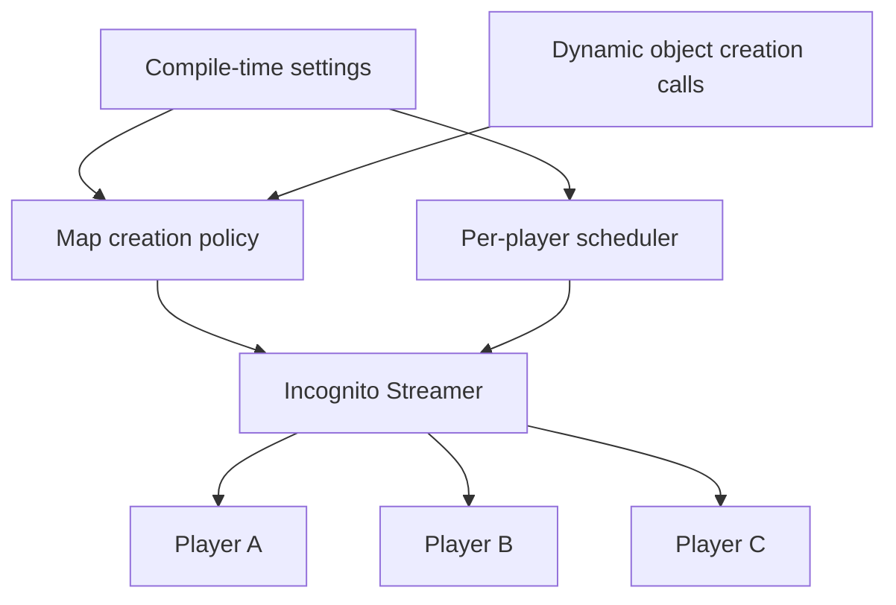

# MapPulse

**Author:** [0xOgysha](https://github.com/0xOgysha) · Created: 2026-11-26 · Copyright (c) 2026 0xOgysha

**English** | [Srpski](README-SR.md)

**Adaptive map streaming and intelligent object prioritization for SA-MP and open.mp.**


MapPulse is a lightweight Pawn extension built on top of the Incognito Streamer plugin. It combines mathematical movement estimation, capacity-aware streaming radius adjustments and model-based object prioritization to make better use of the available object streaming budget.

The project was designed around a simple principle: **optimize automatically, without requiring players to reload maps manually.** MapPulse is not a replacement for Streamer; it provides an additional policy layer for existing gamemodes.

> **Development status:** v0.8.0 is an experimental source release. SA-MP 0.3.7 and open.mp are intended targets; successful compilation, runtime compatibility and performance improvements have not yet been verified on both platforms. Test on a staging server before production deployment.

## Contents

- [Features](#features)
- [Requirements](#requirements)
- [Installation](#installation)
- [Architecture](#architecture)
- [Mathematical approach](#mathematical-approach)
- [Object policy](#object-policy)
- [Configuration](#configuration)
- [Administrator commands](#administrator-commands)
- [Dependency checks](#dependency-checks)
- [Benchmarking](#benchmarking)
- [Limitations and troubleshooting](#limitations-and-troubleshooting)
- [Contributing](#contributing)

## Features

- Automatic per-player streaming radius management based on sampled movement and available object capacity.
- Creation-time policy for `CreateDynamicObject` and `CreateDynamicObjectEx`.
- Model-based priorities and selective reduction of decorative streaming distances.
- A single shared timer with a bounded round-robin workload over connected players.
- Squared-distance comparisons, smoothed squared-speed estimation and occupancy prediction.
- Hysteresis, stable-sample requirements and rate-limited radius adjustments.
- No `OnPlayerUpdate` processing and no forced `Streamer_Update` or `Streamer_UpdateEx` calls.
- Preservation of explicit non-zero object priorities and external per-player radius changes where detected.
- Startup ASCII banner, dependency diagnostics, RCON-only commands and A/B reports.
- Centralized compile-time configuration; no MapPulse runtime configuration file or database required.

## Requirements

| Dependency | Recommended baseline / requirement | Purpose |
| --- | --- | --- |
| SA-MP 0.3.7 or open.mp | Compatible server and Pawn compiler | Server runtime |
| `a_samp.inc` | Compatible with the target server | Pawn server API; also required when compiling the filterscript for open.mp |
| [Incognito Streamer](https://github.com/samp-incognito/samp-streamer-plugin/releases) | 2.9.6 (`0x296`) or compatible newer build | Dynamic object API; matching plugin and `streamer.inc` required |
| [Pawn.CMD](https://github.com/katursis/Pawn.CMD/releases) | 3.4.0 for SA-MP; [3.4.0-omp](https://github.com/katursis/Pawn.CMD/releases/tag/3.4.0-omp) for open.mp | Optional command processor; enabled by default |

Install the server-specific binaries and their matching include files. A gamemode using `CreateDynamicObject` or `CreateDynamicObjectEx` is required for the creation-time policy to affect its maps. The filterscript can run independently, but only provides per-player radius management.

No YSI, MySQL, sscanf or extra MapPulse plugin is required. Existing gamemode dependencies are unaffected. On open.mp, use an appropriate SA-MP compatibility include and the correct Pawn.CMD component if enabled. Disable Pawn.CMD in the settings if it is not installed.

## Installation

### 1. Copy the source files

```text
MapPulse/
├── filterscripts/
│   ├── mappulse.pwn
│   └── mappulse_live.inc
└── include/
    ├── mappulse_maps.inc
    └── mappulse_settings.inc
```

Copy both filterscript files to your server's `filterscripts/` directory. Copy both public include files to your compiler's include directory (typically `pawno/include/` on SA-MP or `qawno/include/` on open.mp, or another configured include path). Ensure `streamer.inc` and, if enabled, `Pawn.CMD.inc` are available to the compiler with the exact casing expected by the source (`<Pawn.CMD>`).

### 2. Enable the map creation policy

Add the include to your gamemode **after the Streamer include and before any map creation code or included modules that create objects**:

```pawn
#include <a_samp>
#include <streamer>
#include <mappulse_maps>
```

For a gamemode already using open.mp's native include layout, retain its existing server API includes and add MapPulse after Streamer. Do not add a second conflicting server API include.

Existing dynamic object calls do not need to be rewritten:

```pawn
new objectid = CreateDynamicObject(19448, 1000.0, 1000.0, 20.0,
    0.0, 0.0, 0.0);
```

The include redirects subsequent calls in that compilation unit through MapPulse's wrappers. Both creation APIs are supported. No manual `#undef` or end include is required. Calls in separate filterscripts or other AMX scripts are unaffected unless they include the same map module themselves. Existing objects are not retroactively modified.

Optionally, add the following line to your **existing** `OnGameModeInit`, after creating the maps:

```pawn
MPM_PrintStats();
```

It prints the number of successfully created, prioritized and distance-trimmed objects. These counters are cumulative per script, not a scan of currently existing objects. The first wrapped object creation also triggers the cached Streamer include-version check.

### 3. Compile and load the filterscript

Compile `filterscripts/mappulse.pwn` into `filterscripts/mappulse.amx`. Recompile the gamemode if you installed the map include.

For SA-MP, append `mappulse` to the existing `filterscripts` line in `server.cfg`:

```ini
filterscripts mappulse
```

For open.mp, append `filterscripts/mappulse` to the existing `pawn.side_scripts` array in `config.json`:

```json
{
  "pawn": {
    "side_scripts": ["filterscripts/mappulse"]
  }
}
```

These are minimal examples; keep all existing entries and configuration. Load Streamer as a compatible server plugin and Pawn.CMD, if enabled, according to its platform-specific installation instructions. The open.mp Pawn.CMD build belongs in the server's `components/` directory. Do not load old SmartMap, PawnMapFlow or additional MapPulse filterscripts alongside this one.

### 4. Start and verify

Start the server, review the dependency messages and use `/mpstatus` as an RCON administrator. With the default settings, individual optimization starts automatically. Players do not need any commands.

MapPulse settings are compiled into the scripts; the server configuration above is only used to load the filterscript.

## Architecture

| File | Responsibility |
| --- | --- |
| `filterscripts/mappulse.pwn` | Filterscript entry point, lifecycle callbacks, optional native command dispatch and dialog responses |
| `filterscripts/mappulse_live.inc` | Player scheduler, movement estimation, radius policy, diagnostics, A/B tests and commands |
| `include/mappulse_maps.inc` | Dynamic object wrappers, model classification, creation policy and counters |
| `include/mappulse_settings.inc` | All 60 user-configurable defines, compile-time validation and dependency checks |



The two modules complement each other. The include controls eligible object parameters when the objects are created; the filterscript manages the radius multiplier independently for each eligible player. Neither module replaces the underlying Streamer implementation.

## Mathematical approach

MapPulse uses simple numerical methods rather than performing expensive per-object calculations on each player update. The formulas below describe the implemented v0.8.0 policy, not measured performance results.

### 1. Squared Euclidean distance and speed

For successive positions, the squared displacement is:

$$d^2 = (x_t-x_{t-1})^2+(y_t-y_{t-1})^2+(z_t-z_{t-1})^2$$

With a sampling interval $\Delta t$ in milliseconds, the squared speed estimate in $(\mathrm{km/h})^2$ is:

$$v^2 = d^2\left(\frac{3600}{\Delta t}\right)^2$$

The unit conversion treats game coordinates as metres. Comparing squared speeds with squared thresholds avoids computing square roots in the normal automatic optimization path. Square roots are used when reporting actual speeds and route distances in administrative diagnostics.

### 2. Exponential smoothing

A weighted moving estimate reduces abrupt changes caused by individual samples:

$$s_t=(1-\alpha)s_{t-1}+\alpha v_t^2$$

Here $s_t$ is the smoothed squared speed and $\alpha$ is `MPL_SPEED_WEIGHT` (default 0.5). Threshold comparisons use this smoothed value. This is an estimate from position samples, not a direct measurement of vehicle speed.

Large displacements, excessive sampling gaps and world/interior changes reset movement estimation. The displacement threshold is `max(MPL_JUMP_DISTANCE, MPL_JUMP_METERS_PER_MS × elapsed_ms)`. These events do not force a Streamer update.

### 3. Capacity-aware radius prediction

Define $N$ as the currently visible dynamic object count and $L$ as the configured per-player visible object limit. Let $r_0$ be the original radius multiplier, $r_c$ the current multiplier and $q$ the target occupancy fraction (default 0.75).

With an approximately uniform two-dimensional object distribution, the number of nearby objects grows proportionally to the square of the radius. For a proposed factor $f$ relative to the original multiplier:

$$\widehat{N}(f)=N\left(\frac{r_0f}{r_c}\right)^2$$

Requiring $\widehat{N}(f)\leq qL$ yields:

$$f^2\leq\frac{qL}{N}\left(\frac{r_c}{r_0}\right)^2$$

MapPulse evaluates this inequality directly instead of computing a square root. For zero visible objects the estimate is skipped. The candidate factor is selected from the configured speed tiers; if the budget rejects the largest tier, the algorithm tries the middle tier and then the original radius. The configured absolute multiplier cap is also applied without deliberately lowering the existing baseline.

This area-based approximation is a heuristic. Dense clusters, multilevel interiors, object priorities and nonuniform streaming distances can produce different results from the predicted count.

### 4. Hysteresis and scheduling

At 85% occupancy the default policy enters a high-pressure state and returns to the original radius where MapPulse owns the setting. It must fall to 60% or below before an increase is considered again. Regular changes require three stable speed samples, a six-second adjustment interval and a minimum multiplier difference.

A shared 100 ms timer visits at most 16 active slots per pass, with a soft 2 ms work budget. Normal samples are spaced at least 1.5 seconds apart; eligible idle players without an active radius modification use 2.5 seconds. The active-player list uses swap removal rather than scanning all possible player slots every tick. Actual intervals can be longer under load. The time budget is checked after individual operations and is not a hard real-time guarantee.

## Object policy

The default map policy only modifies creation calls with priority `0`, positive stream distance and unrestricted player/area filters, in world/interior `0` or `-1`. For the extended API, each world, interior, player and area array must contain exactly one compatible entry. Other calls are forwarded without policy changes.

| Category | Default priority / policy |
| --- | --- |
| High-priority model list | `3` |
| Medium-priority model list | `2` |
| Selected decorative model (`14400`) | Stream distance × `0.85`, subject to bounds |
| Other models or explicit nonzero priority | Original parameters |

The model lists are configurable and should be reviewed for each server's maps. Model IDs are not proof that an object is a floor, wall or purely decorative item in a particular scene. The default lists include selected construction models, not all possible structural objects.

For the decorative rule, the original stream distance must be between 120 and 500 units. The proposed distance is the maximum of 85% of the original distance, 120 units and the supplied draw distance. The change is applied only if the reduction exceeds 5 units. Draw distance itself is not changed.

The wrappers preserve positions, rotations, world/interior/player/area restrictions and explicit nonzero priorities. They do not automatically identify future moving gates or attached objects; review those models if your gamemode uses them. Objects created with ordinary `CreateObject` are outside this policy.

## Configuration

All options reside in `include/mappulse_settings.inc`. Each user-facing define has a Serbian explanatory comment. Edit the existing values and recompile the affected scripts. Defaults are conservative starting points, not universal optimal settings.

For example, to use native commands instead of Pawn.CMD and disable decorative trimming, edit these existing definitions:

```pawn
#define MPL_USE_PAWNCMD (0)
#define MPM_TRIM_DECOR (0)
```

Options are guarded with `#if !defined`, so they can also be overridden before including the module. Overrides only affect the script being compiled. For consistent configuration across the gamemode and filterscript, edit the shared settings file.

### General (8)

| Define | Default | Description |
| --- | --- | --- |
| `MPL_START_ENABLED` | `1` | Enable automatic per-player optimization at startup. |
| `MPL_USE_PAWNCMD` | `1` | Use Pawn.CMD (1) or native command callbacks (0). |
| `MPL_DIALOG_BRIDGE` | `0` | Use the host dialog callback instead of direct dialogs. |
| `MPL_DIALOG_ID` | `32740` | Reserve this administrative dialog ID in your gamemode. |
| `MPL_COLOR` | `0xA9DEFFFF` | RGBA color for MapPulse chat messages. |
| `MPL_PRINT_BANNER` | `1` | Print the startup ASCII banner. |
| `MPL_SAVE_RESULTS` | `1` | Save completed A/B reports to disk. |
| `MPL_RESULTS_FILE` | `"mappulse_performance_results.log"` | Result filename under `scriptfiles/`. |

### Dependency checks (3)

| Define | Default | Description |
| --- | --- | --- |
| `MPL_STREAMER_RECOMMENDED` | `0x296` | Recommended Streamer header version, hexadecimal. |
| `MPL_PAWNCMD_RECOMMENDED` | `0x030400` | Recommended Pawn.CMD header version, hexadecimal. |
| `MPL_DEP_STRICT` | `0` | Reject old or unknown headers (1), or warn and continue (0). |

### Scheduler (7)

| Define | Default | Description |
| --- | --- | --- |
| `MPL_TICK` | `100` | Shared scheduler timer interval (ms). |
| `MPL_PLAYER_MS` | `1500` | Minimum normal sampling interval (ms). |
| `MPL_IDLE_MS` | `2500` | Idle sampling interval (ms). |
| `MPL_WORK_PER_TICK` | `16` | Maximum active slots visited per timer pass. |
| `MPL_CPU_BUDGET_MS` | `2` | Soft timer-pass work budget (ms). |
| `MPL_ADJUST_MS` | `6000` | Minimum interval between regular radius adjustments (ms). |
| `MPL_STABLE_SAMPLES` | `3` | Consecutive samples in the same speed tier before regular adjustment. |

### Movement (8)

| Define | Default | Description |
| --- | --- | --- |
| `MPL_MAX_GAP_MS` | `15000` | Maximum sampling gap before movement is reset (ms). |
| `MPL_JUMP_DISTANCE` | `150.0` | Minimum displacement threshold for jump detection (game units). |
| `MPL_JUMP_METERS_PER_MS` | `0.12` | Time-scaled displacement threshold (units/ms). |
| `MPL_SPEED_WEIGHT` | `0.5` | Weight of new squared-speed sample (0–1). |
| `MPL_IDLE_SPEED` | `2.0` | Idle speed threshold (km/h). |
| `MPL_WALK_SPEED` | `4.0` | Minimum speed for adaptive radius processing (km/h). |
| `MPL_DRIVE_SPEED` | `25.0` | Middle speed tier threshold (km/h). |
| `MPL_FAST_SPEED` | `90.0` | Highest speed tier threshold (km/h). |

### Radius and capacity (9)

| Define | Default | Description |
| --- | --- | --- |
| `MPL_EPS` | `0.005` | Floating-point comparison and external-change tolerance. |
| `MPL_MIN_CHANGE` | `0.025` | Minimum multiplier difference for a regular write. |
| `MPL_MAX_MULTIPLIER` | `1.5` | Absolute multiplier cap; existing higher baseline is preserved. |
| `MPL_PRESSURE_HIGH` | `85` | High-pressure occupancy threshold (%). |
| `MPL_PRESSURE_LOW` | `60` | Low-pressure release threshold (%). |
| `MPL_TARGET_OCCUPANCY` | `75` | Target occupancy for the prediction (%). |
| `MPL_WALK_FACTOR` | `1.0` | Low-speed factor relative to original multiplier. |
| `MPL_DRIVE_FACTOR` | `1.10` | Middle-speed factor relative to original multiplier. |
| `MPL_FAST_FACTOR` | `1.20` | High-speed factor relative to original multiplier. |

### Object creation policy (12)

| Define | Default | Description |
| --- | --- | --- |
| `MPM_ENABLE` | `1` | Enable the creation-time object policy. |
| `MPM_ENABLE_PRIORITY` | `1` | Enable model-based priorities. |
| `MPM_PRIORITY_HIGH` | `3` | Priority for the high model list. |
| `MPM_PRIORITY_MEDIUM` | `2` | Priority for the medium model list. |
| `MPM_HIGH_MODELS` | `18762,18766,19378,19381,19447,19448` | Comma-separated high-priority model IDs. |
| `MPM_MEDIUM_MODELS` | `19362,19429,19433,19435,19436,19438,19446,19456,19457,19458,19459` | Comma-separated medium-priority model IDs; no overlap with high list. |
| `MPM_TRIM_DECOR` | `1` | Enable selective decoration distance trimming. |
| `MPM_DECOR_MODEL` | `14400` | Model ID eligible for decoration trimming. |
| `MPM_DECOR_MIN_SD` | `120.0` | Minimum eligible original distance and lower bound (units). |
| `MPM_DECOR_MAX_SD` | `500.0` | Maximum eligible original distance (units). |
| `MPM_DECOR_FACTOR` | `0.85` | Decorative distance factor relative to original. |
| `MPM_DECOR_MIN_CHANGE` | `5.0` | Minimum reduction threshold; reduction must exceed this (units). |

### A/B diagnostics (7)

| Define | Default | Description |
| --- | --- | --- |
| `MPL_AB_MIN_SAMPLES` | `15` | Minimum samples in each A/B run. |
| `MPL_AB_ROUTE_REL` | `0.15` | Relative route-length tolerance (fraction). |
| `MPL_AB_ROUTE_ABS` | `10.0` | Additional absolute route-length tolerance (units). |
| `MPL_AB_ENDPOINT_DISTANCE` | `50.0` | Maximum XY separation of matching route endpoints (units). |
| `MPL_AB_SPEED_REL` | `0.20` | Relative maximum-speed tolerance (fraction). |
| `MPL_AB_SPEED_ABS` | `5.0` | Additional maximum-speed tolerance (km/h). |
| `MPL_AB_DELTA_PP` | `2.0` | Minimum meaningful difference in full-capacity sample share (percentage points). |

### Tuning guidance

Start with the defaults. If the server is CPU-constrained, increase sampling intervals or reduce the work budget per pass; this also makes adaptation slower. If maps are dense, keep radius factors close to `1.0`, and validate the object model policy before expanding it. Set `MPM_TRIM_DECOR` to `0` if the selected model is important to your map. Keep occupancy thresholds ordered and avoid overlapping model lists. Some invalid integer settings are rejected at compilation; floating-point ranges still require manual review.

## Administrator commands

All commands require RCON administrator access through `IsPlayerAdmin`. They are for maintenance and testing only.

| Command | Description |
| --- | --- |
| `/mpstatus` | Player radius, speed, visible objects, limit, pressure, conflict and scheduler statistics |
| `/mpbase` | Start test A using the original per-player radius |
| `/mpon` | Start test B with adaptive individual optimization |
| `/mpoff` | Finish the active test, display and optionally save results |
| `/mpcompare` | Display stored A/B results |
| `/mpliveon` | Enable automatic individual optimization for all players |
| `/mpliveoff` | Disable individual optimization, stop active tests and gradually restore owned radius settings |

The default report uses a native `DIALOG_STYLE_TABLIST_HEADERS` dialog with ID `32740`. Reserve this ID or select another unused ID. If your gamemode has a centralized dialog manager, set `MPL_DIALOG_BRIDGE` to `1` and implement the public callback `MapPulse_ShowReport(playerid, const title[], const body[])` in the host script using its existing authorized dialog mechanism. The host callback must render the supplied tab-separated rows with `DIALOG_STYLE_TABLIST_HEADERS`. The callback is invoked through `CallRemoteFunction`; the host must implement and test it. Do not disable anti-cheat or dialog safeguards to accommodate MapPulse.

Disabling the live optimizer does not undo creation-time object priorities or distances. To revert those, disable the map policy, recompile the affected script and recreate its maps or restart the server with the modified script.

## Dependency checks

The filterscript checks dependencies once at initialization and prints the configured header baselines, warning messages and a read-only Streamer API probe for tick rate, visible-object limit and radius multiplier. The map module checks the Streamer header once per script when first used (or when `MPM_PrintStats()` is called).

If the required header version macro is missing, MapPulse reports an unknown/old version rather than claiming verification. In strict mode, a failed header check prevents the corresponding optimization from running. A failed Streamer API probe prevents the individual optimizer from starting regardless of strict mode.

Pawn does not expose a dependable binary-version getter through these dependencies' public APIs. Check the plugins' own startup banners and mismatch warnings; dependency checks are separate from the MapPulse online version check. Missing natives can prevent the AMX from loading before its startup code executes.

### Automatic MapPulse version check

MapPulse v0.8.0 checks the public [VERSION](VERSION) file once per AMX: the filterscript at load and the map include at first object creation or MPM_Init(). Calling MPM_Init() is optional if you want the banner before any map creation. This is a non-blocking, warning-only check; it never downloads executable code, sends player data or installs updates. GitHub receives ordinary network request metadata.

| Define | Default | Purpose |
|---|---|---|
| MPL_UPDATE_CHECK | 1 | 0 disables online checks |
| MPL_UPDATE_TRANSPORT | 1 | 1 native HTTP; 2 optional pawn-requests HTTPS |
| MPL_UPDATE_URL | GitHub VERSION URL | Native HTTP endpoint; open.mp headers select HTTPS |
| MPL_UPDATE_HOST | https://raw.githubusercontent.com | HTTPS host for pawn-requests |
| MPL_UPDATE_PATH | /0xOgysha/MapPulse/main/VERSION | Path for pawn-requests |
| MPL_UPDATE_TIMEOUT_MS | 15000 | Response timeout |

Legacy SA-MP HTTP does not reliably support HTTPS/redirects. If checking fails, install a compatible [pawn-requests](https://github.com/Southclaws/pawn-requests) binary and include (0.11.x Request API) and select MPL_UPDATE_TRANSPORT=2, or use your own HTTP mirror. On open.mp compiled with old SA-MP headers, explicitly set MPL_UPDATE_URL to the HTTPS endpoint. The optional plugin requires matching binaries and includes. Network failures do not disable optimization. When publishing an update, change VERSION and all module version constants. Replace all source files together and recompile.

## Benchmarking

Use a staging server with the same map layout, object limit and configuration as the intended production environment.

1. Use `/mpbase`, follow a repeatable route, then `/mpoff`.
2. Use `/mpon`, repeat the same route at a similar speed, then `/mpoff`.
3. Inspect `/mpcompare` and the scheduler statistics in `/mpstatus`.
4. Repeat at different player counts and map densities. Measure client frame times separately, along with server CPU usage and streaming behavior.

The report includes sample count, mean/peak visible objects, configured limit, occupancy, full-capacity samples, approximate route length, maximum smoothed speed, radius changes and discontinuities. It checks route length, endpoints, initial world/interior, speed, stable object limits and absence of detected jumps before labeling runs comparable. By default each run needs at least 15 samples. A/B reports can be saved to `scriptfiles/mappulse_performance_results.log`.

The built-in A/B comparison isolates the individual radius policy **with the same creation-time map policy in both runs**. To evaluate creation-time priorities and distance trimming, run separate server builds with `MPM_ENABLE` disabled and enabled, recreating the same maps between tests.

No verified FPS or CPU improvement percentage is published for v0.8.0. Lower saturation does not necessarily mean better visual quality or faster rendering. Report missing objects, pop-in, frame-time spikes and scheduler timings as well as occupancy.

## Limitations and troubleshooting

| Situation | What to check |
| --- | --- |
| Unknown native / AMX loading failure | Verify the required plugin/component, architecture, matching includes and load order; recompile. |
| Pawn.CMD unavailable | Set `MPL_USE_PAWNCMD` to `0`, then recompile the filterscript. |
| Dialog conflicts | Reserve a unique dialog ID or integrate the host dialog bridge. |
| No automatic radius change | Check eligibility, speed tiers, pressure, stable samples, existing radius and conflicts in `/mpstatus`. |
| No priority changes | Verify include order, matching model IDs, original priority and world/interior/player/area filters. Objects must be created after compilation with the wrapper. |
| Unexpected missing decorations | Disable `MPM_TRIM_DECOR` and recreate maps; review the selected model. |
| Another system controls the player radius | MapPulse yields when an external change is detected while it owns the radius. Reconnect to clear the conflict flag; avoid multiple radius controllers. |

MapPulse cannot increase the GTA:SA client's physical rendering capacity or remove engine object limits. It does not delete duplicate objects, rewrite map geometry, modify draw distance, guarantee collision availability, or promise zero lag/FPS drops. Interior radius adaptation is skipped by default logic, and camera-driven updates, NPCs and ineligible player states are excluded. Existing maps in other AMX scripts are not automatically intercepted by the include. Compatibility with other macro wrappers, custom dialog managers and runtime moving or attached objects must be tested per gamemode.

## Contributing

Reproducible bug reports and performance comparisons are welcome. Include the server platform/version, compiler version, Streamer and Pawn.CMD versions (if used), relevant settings, compilation output, minimal reproduction code and anonymized logs. For performance reports, include player count, map density, route, object limit, server timings and client frame-time measurements where available.

When proposing changes, preserve the automatic workflow, original object parameters outside the configured policy, bounded scheduler work and compatibility with the supported creation APIs. Avoid introducing per-player update callbacks or forced refresh loops without a measured justification.

## Credits and references

MapPulse is an independent project built around the [Incognito Streamer plugin](https://github.com/samp-incognito/samp-streamer-plugin). It optionally integrates [Pawn.CMD](https://github.com/katursis/Pawn.CMD) and targets the [open.mp](https://open.mp/) and SA-MP server ecosystems. These projects are independent dependencies, not bundled or affiliated with MapPulse.

Useful upstream documentation: [Streamer wiki](https://github.com/samp-incognito/samp-streamer-plugin/wiki), [open.mp server configuration](https://open.mp/docs/server/config.json), [open.mp filterscript loading](https://open.mp/docs/server/ControllingServer).

## License

MapPulse is licensed under the [MIT License](LICENSE). Third-party dependencies retain their respective licenses.
